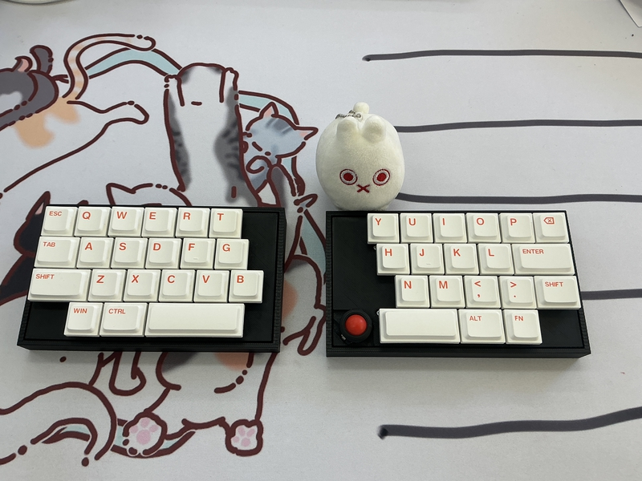

# Initest40(cool940tb)

## Initest40?

Initest40は40％分割、トラックボール、ロータリエンコーダを付属しているキーボードです。
 
zmk_firmwareにより、BT無線接続ができ、乾電池（単４電池４本）で動作します。
 

## Firmware?

https://github.com/telzo2000/zmk-config-cool940tb

## kicad?

データを置いておくので、ライセンスに沿って活用してください。
 

## Case?

データを置いておくので、ライセンスに沿って活用してください。
 
STLファイル以外の希望に沿うことはありません。
 

## BOM

Coming soon
 

## Build guide

Coming soon
 

